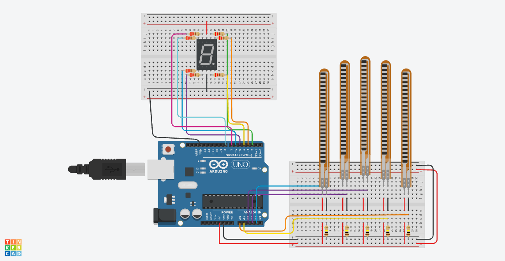

# Sign Language Translator Glove (Numbers 1–9)

This project is part of my **TKS Build Phase**. It features a sign language translation glove designed to read hand gestures for numbers **1 through 9** using an Arduino Uno and flex sensors attached to each finger.

---

## 🛠️ Interactive Tinkercad Simulation

You can view and test the complete circuit simulation online:
**[View Tinkercad Simulation](https://www.tinkercad.com/things/2pK7bZvhzvH-flex-glove-tks?sharecode=urHjeWdTLJ9Q2QnliufdLfcKO60W2fz48AL-rJ4NTxY)**

---

## 📌 Project Overview

* **Microcontroller:** Arduino Uno
* **Sensors:** 5x Flex Sensors (connected to analog pins A0–A4)
* **Goal:** Translate finger bending resistance values into digital outputs representing numbers 1 to 9.

---

## 📊 Experimental Results & Sensor Data

Here are the serial monitor readings obtained for each hand gesture (Numbers 1 through 9):

![You can read Results.md]

---

## 🚀 How It Works

1. **Hardware Setup:** Five flex sensors measure the bend angle of each finger.
2. **Analog Reading:** The Arduino reads raw analog values (from 0 to 1023) through pins A0 to A4.
3. **Serial Monitor:** Values are printed in real-time to detect patterns corresponding to each number.

---

## ⚙️ Repository Structure

* `glove_code_1.ino` — Arduino code for reading sensor data.
* `glove_code_2.ino` — Arduino code for reading sensor data.
* `README.md` — Project documentation and guide.
