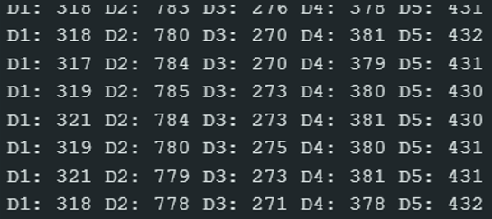
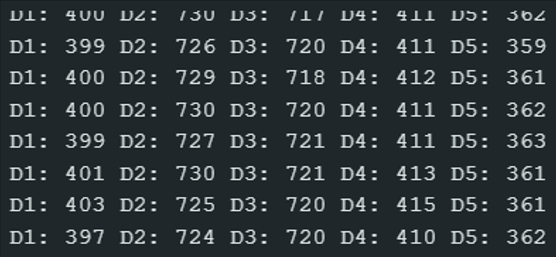
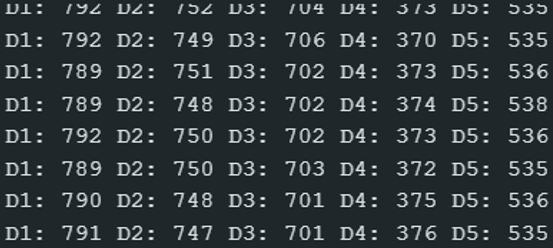
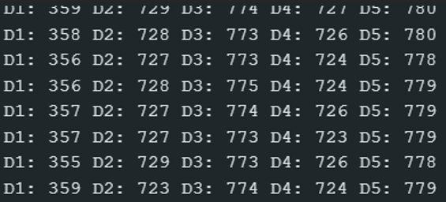
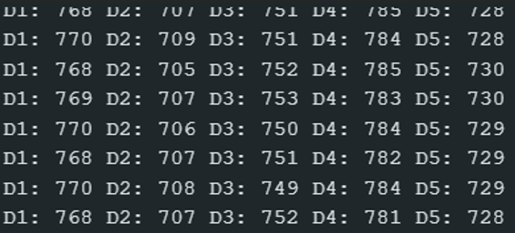
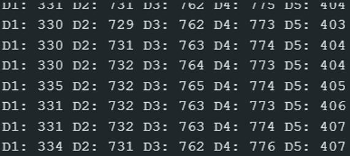
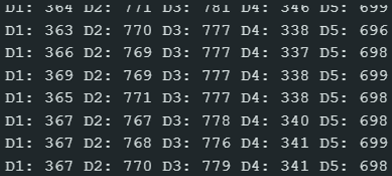
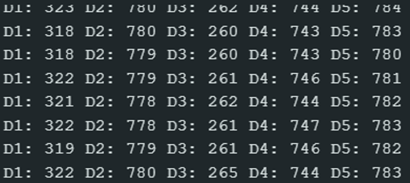
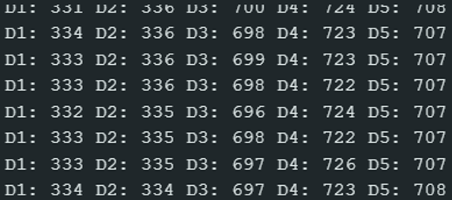

# Sign Language Translator Glove Replica (Numbers 1 through 9)

This section presents the results obtained from the sensor readings for each of the numbers from 1 to 9 as interpreted by the glove.

D1: refers to the thumb
D2: refers to the index finger
D3: refers to the middle finger
D4: refers to the ring finger
D5: refers to the little finger

## Experimental Results

| Number 1 | Number 2 |
| :---: | :---: |
|  |  |

| Number 3 | Number 4 |
| :---: | :---: |
|  |  |

| Number 5 | Number 6 |
| :---: | :---: |
|  |  |

| Number 7 | Number 8 |
| :---: | :---: |
|  |  |

| Number 9 | |
| :---: | :---: |
|  | |
